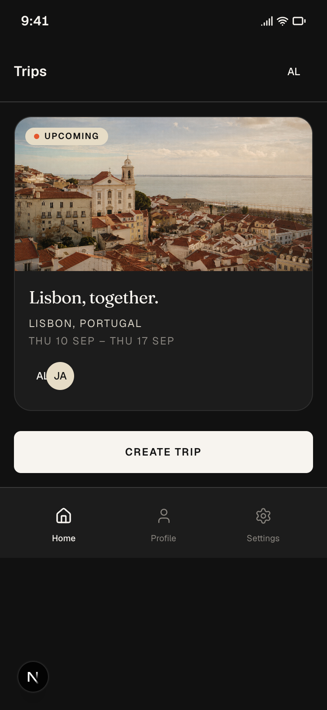

# TripTogether

**Plans are better together.**

TripTogether is a collaborative trip planner. A group shares one trip: where you’re going, what happens each day, what to pack, decisions to vote on, and who paid for what.

This repo is a **clickable frontend prototype** of that app. No backend, no real accounts, no live sync. Pick a demo person, plan together in the browser, and data stays in `localStorage` until you reset it.



## The app

1. **Choose who you are** — Alex, Jamie, or Priya (or add someone). This stands in for login.
2. **See your trips** — photo hero for Portugal 2026, Donegal in the list, plus create a new trip.
3. **Plan the trip**
   - **Trip** — overview, members, cover
   - **Plan** — itinerary by day
   - **Lists** — packing and to-dos with icons and assignees
   - **Votes** — group decisions with live vote bars
   - **Money** — shared expenses, even split, paid-by
4. **You** — name, colour, theme, currency (€ £ $), and reset demo

On a laptop the UI sits in an iPhone frame. On a phone it fills the screen.

## Run it

```bash
git clone https://github.com/nearform/leapsome_patty_todo.git
cd leapsome_patty_todo
npm install
npm run dev
```

Then open:

**[http://localhost:3000/prototype/journeys/trip-planner/profile-switcher](http://localhost:3000/prototype/journeys/trip-planner/profile-switcher)**

Needs Node.js 18+ and npm.

## Screens

| Screen | Route |
|--------|--------|
| Profile switcher | `/prototype/journeys/trip-planner/profile-switcher` |
| Trips home | `/prototype/journeys/trip-planner/trips-home` |
| Create trip | `/prototype/journeys/trip-planner/create-trip` |
| Trip overview | `/prototype/journeys/trip-planner/trip-overview` |
| Itinerary | `/prototype/journeys/trip-planner/itinerary` |
| To-dos & packing | `/prototype/journeys/trip-planner/todos` |
| Decisions | `/prototype/journeys/trip-planner/polls` |
| Budget | `/prototype/journeys/trip-planner/budget` |
| My profile | `/prototype/journeys/trip-planner/my-profile` |
| Settings | `/prototype/journeys/trip-planner/settings` |

## Demo data

Seeded in `src/lib/data/trip-planner-seed.ts`:

- **People:** Alex, Jamie, Priya
- **Portugal 2026** — Lisbon, Sep 10–13, with itinerary, packing, a poll, and expenses
- **Donegal weekend** — Dunfanaghy, Oct 23–25

**Reset demo** in Settings restores this seed. Cover photos live in `public/images/trip-planner/`.

## Look and feel

Editorial travel brand: ivory page, charcoal type and buttons, terracotta only as a decorative accent. **Fraunces** for titles, **Geist** for UI. Logo is a serif **TT** in a circle plus a tracked **TRIPTOGETHER** wordmark.

Details: [docs/triptogether-brand-style-guide.md](./docs/triptogether-brand-style-guide.md)

## Code map

```
src/app/prototype/journeys/trip-planner/   # Every app screen (static folders, not [tripId] routes)
src/app/prototype/journeys/trip-planner/_store/  # React context + localStorage
src/components/prototype-ui/               # Shared buttons, cards, avatars, …
src/lib/data/trip-planner-seed.ts          # Starting demo state
src/lib/types/trip-planner.ts              # Types
```

The active trip is stored in context, not in the URL.

## Also in this repo

The app is built on a Next.js 16 / React 19 / Tailwind design-system workspace. Extra routes:

| Route | What |
|-------|------|
| `/` | Workspace home |
| `/prototype` | Journey list |
| `/design-system` | Component gallery |
| `/canvas` | All screens on one board |

```bash
npm run build         # Production build
npm run lint          # ESLint
npm run screenshots   # Recapture journey stills
```

## Docs

- [MVP scope](./docs/trip-planner-mvp-scope.md)
- [App plan](./docs/trip-planner-app-plan.md)
- [Designer guide](./docs/start-here.md)
- [Session log](./cursor-updates.md)
